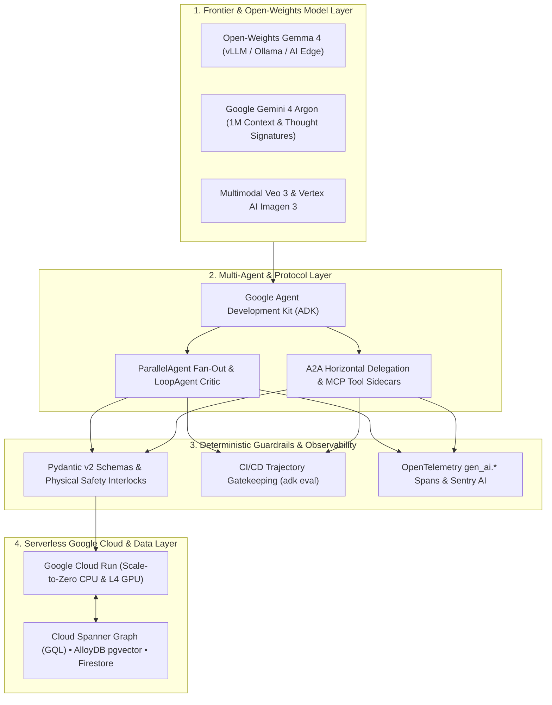

  

  # Robina Mirbahar

  <!-- Dynamic Typing SVG Headline -->
  

   

  📍 Hyderabad, Pakistan &nbsp;|&nbsp; 🥑 GDE (AI & Cloud) &nbsp;|&nbsp; 🇵🇰 IEEE AI Caravan PK Lead &nbsp;|&nbsp; 📚 Published Author &nbsp;|&nbsp; 🎤 Global Speaker

   

  
  [-FF9900?style=for-the-badge&logo=amazon&logoColor=white)](https://amazon.com/dp/B0GWCZWCF4)
  
  
  
  
  
  
  

    

  

---

## 👩‍💼 About Me

AI Researcher, Cloud Solutions Architect, and Author with 6+ years of experience designing scalable multi-cloud infrastructure and building production-grade Generative AI systems. I bridge cutting-edge AI research with production engineering while empowering global tech communities and championing women in STEM.

* 🤖 **Agentic AI & Generative Systems** — Multi-Agent Loops · Advanced RAG · Gemma & Gemini APIs · LangGraph
* 🇵🇰 **Pakistan Lead @ IEEE AI Caravan** — Leading national initiatives across a global network of 94 countries
* 📚 **Published Author** — Author of *"AI Engineering: From Classical ML to RAG & Agentic AI Systems"* (2026)
* 🔬 **Peer Reviewer** — Women in Machine Learning (WiML) at **NeurIPS 2026**
* ⚖️ **Official Tech Competition & Hackathon Judge** — Judge for Google Cloud & Google for Developers **"All Things Agentic" Hackathon** on [Devpost](https://allthingsagentichackathon.devpost.com/)
* ☁️ **Multi-Cloud Architect** — Google Cloud Platform · AWS · Microsoft Azure · Kubernetes · Terraform
* 🚀 **Mentor @ Google for Startups** — Advising AI/ML founders on architecture and scalability
* 💜 **Women Techmakers Ambassador** — Chapter Lead, Hyderabad, Pakistan

---

---

## 🏗️ My Production Agentic AI & Multi-Cloud Reference Architecture

---

## 🚀 Featured Open-Source Google Cloud & Agentic AI Architectures (2026)

| Repository | Architecture & Tech Stack | Live Status |
| :--- | :--- | :--- |
| **[antigravity-science-plugin-cookbook](https://github.com/RobinaMirbahar/antigravity-science-plugin-cookbook)** | **Google Antigravity Science Plugin (`v1.3.1`) Cookbook & 3D WebGL Biomolecular Studio** - 41 Progressive-Disclosure Skills, AlphaGenome, AlphaFold, DeepMind Aeneas/Ithaca, 3D Mol* Sidecar & 3 Custom Plugins |   |
| **[gemini-4-argon-cookbook](https://github.com/RobinaMirbahar/gemini-4-argon-cookbook)** | **Google DeepMind Gemini 4 Argon (`gemini-4-argon`) Cookbook & Live 3D Studio** - 1M/1M Unified Token Horizon, Long-Decode Continuation Protocol, Cryptographic Thought Signatures & Pure-Python 3D Raytracer |   |
| **[railpulse-gemma-cloudrun](https://github.com/RobinaMirbahar/railpulse-gemma-cloudrun)** | **RailPulse AI (DevFest Baku 2026 Hands-On Lab)** — Live Rail Tracking & Trilingual (`EN`/`AZ`/`RU`) Smart Dispatch Agent powered by Open-Weights Gemma, Google ADK Function Calling, Deterministic Safety Interlocks, SVG Telemetry Gauges & Cloud Run |   |
| **[CoThread](https://github.com/RobinaMirbahar/CoThread)** | **CoThread** — Enterprise Collaborative AI Platform on Google Cloud Run, Firestore, Google ADK & MCP with Host-Sponsored Token Quotas *(Project Lead: Robina Mirbahar \| Co-Builder: Muhammad Hasnain)* |   |
| **[gemma4-multilora-adk-eval](https://github.com/RobinaMirbahar/gemma4-multilora-adk-eval)** | **Dynamic Multi-LoRA Hot-Swapping & CI/CD Agent Evaluation (`adk eval`)** on Cloud Run NVIDIA L4 GPUs with Gemma 4, vLLM & Cloud Storage FUSE |   |
| **[slothsre-napops](https://github.com/RobinaMirbahar/slothsre-napops)** | **SlothSRE ("NapOps")** — Overnight Gemma 4 & Google ADK Incident Digest Agent with OpenTelemetry `gen_ai.*` Spans & Sentry AI Monitoring |   |
| **[streamforge-event-adk](https://github.com/RobinaMirbahar/streamforge-event-adk)** | **StreamForge** — Real-Time Event-Driven Multi-Agent Pipelines on Google Cloud with ADK (`ParallelAgent` & `LoopAgent`), Eventarc & Pub/Sub |   |
| **[a2a-mcp-mesh-cloudrun](https://github.com/RobinaMirbahar/a2a-mcp-mesh-cloudrun)** | **Agent-to-Agent (A2A) & Multi-MCP Mesh** on Cloud Run with Gemma 4, Google ADK, Spanner Graph (GQL) & AlloyDB (`pgvector` ScaNN) |   |
| **[cloudguard-gemma-agent](https://github.com/RobinaMirbahar/cloudguard-gemma-agent)** | **CloudGuard** — 6-Part Production Gemma Enterprise Agent Platform (ADK, Cloud Run GPU, Firestore, Model Armor, Vertex AI QLoRA) |   |
| **[cozy-ai-agent-cafe-game](https://github.com/RobinaMirbahar/cozy-ai-agent-cafe-game)** | **Prompt Paws: The Cozy AI Agent Cafe & Bakery** — 60 FPS HTML5 Canvas Simulation Game teaching RAG, Guardrails, Context Caching & Multi-Agent Loops |   |

## 📖 Published Literature

  

> ### 📘 **AI Engineering: From Classical ML to RAG & Agentic AI Systems (2026)**
> An end-to-end practical guide bridging classical machine learning theory with modern enterprise RAG pipelines, autonomous multi-agent coordination, and resilient cloud-to-edge deployment.  
> 👉 **[Available on Amazon](https://amazon.com/dp/B0GWCZWCF4)**

---

## ✍️ Featured Technical Articles (Medium Google Cloud & DEV GDE Community)

  
  

 

| Technical Deep Dive | Topics & Stack | Read on Medium / DEV.to |
| :--- | :--- | :--- |
| **From Ancient Epigraphy to 3D Proteins: Building Plugins, Skills & MCP Sidecars in Google Antigravity** | Google Antigravity (`v1.3.1`), 41 Science Skills, AlphaGenome, AlphaFold, DeepMind Aeneas/Ithaca, 3D Mol* WebGL Sidecar, Reproducibility Hooks |    |
| **Building a Live 3D & 1M-Token Engineering Cookbook with Google DeepMind's Gemini 4 Argon** | `gemini-4-argon`, 1M Input / 1M Output Long-Decode Continuation Protocol, Cryptographic `thought_signature`, WebGL 3D Physics & Pure-Python Raytracer |   |
| **Deep Dive: Autonomous Code Auditing, 40% Python Speedups & Stateful 1M-Token Agents with Gemini 4 Argon** | DeepSWE v1.1 (77.9% SOTA), Multi-File Refactoring, Gemini Interactions API (`client.interactions.create`), Thought Signatures |   |
| **SlothSRE (NapOps): An Overnight Gemma 4 & ADK Agent That Compresses 418 Lines of 3 AM Alerts into a 2-Line Morning Digest** | Gemma 4, Google ADK, OpenTelemetry `gen_ai.*` Spans, Sentry AI Monitoring, Cloud Run Jobs |   |
| **Comic Studio AI: Turning Voice & Text Prompts into 4-Panel Comics with Google AI Studio, Gemini & Imagen** | Google AI Studio, Gemini Multimodal & TTS, Imagen, FastAPI, Google Cloud Run |   |
| **Building Production-Ready Open-Weights AI Agents with Gemma, Google ADK, and Cloud Run GPUs** | Gemma Open-Weights, Google ADK, NVIDIA L4 Cloud Run GPUs, Model Armor, Vertex AI QLoRA |   |
| **Event-Driven Multi-Agent Pipelines on Google Cloud with ADK, Gemma 3 and Eventarc** | Google ADK (`ParallelAgent` & `LoopAgent`), Gemma 3, Cloud Eventarc, Pub/Sub, Cloud Run |   |
| **I Built a Cozy 60 FPS AI Agent Bakery Game (Built with Gemma 4 & Antigravity) to Teach RAG & Guardrails** | Gemma 4, Google Antigravity, HTML5 60 FPS Simulation, RAG, Context Caching, Multi-Agent Loops |   |
| **Architecting Autonomous Lakehouse Agents: Governed Iceberg Analytics with Gemini 2.5 Flash and BigLake** | Gemini 2.5 Flash, BigQuery BigLake, Apache Iceberg, Autonomous Data Agents |   |
| **FreelanceShield AI: Local Open-Weight Gemma Scope Creep Detector & TabPFN Invoice Risk Forecaster** | Local Open-Weight Gemma, TabPFN Tabular Foundation Model, FastAPI, Privacy-First AI |   |
| **Design a Fashion Collection with Vertex AI Imagen 3 & Gemini 2.0** | Google Cloud Vertex AI, Imagen 3, Gemini 2.0 Multimodal Generation |   |
| **Integrating Duet AI into Development Workflow: A Practical Developer Guide** | Google Cloud Duet AI / Gemini Code Assist, Cloud Workstations & IDE Productivity |  |
| **Shine on Your AWS Journey: A Practical Guide to Becoming an AWS Community Builder** | AWS Community Builders, Cloud Architecture & Technical Writing |   |
| **Best Practices for Seamless EKS Cluster Upgrades with Fargate & S3 Data Lake Migration** | Amazon EKS, AWS Fargate, Kubernetes Upgrades, AWS Transfer Family |   |

---

### 🌟 Major Honors & Industry Awards

* 🏅 **Winner:** *Cross-Cutting Leader (Women in Tech / Community / Global Impact)*  
  

* 🏅 **Winner:** *Future Leaders Award 2025 (Global Impact Creator)*  
  

* ✅ **Google Developer Expert (GDE) in AI & Cloud**  
  
  

* ✅ **Pakistan Lead — IEEE Computer Society R8 AI Caravan (2026)** *(Spanning 94 Countries)*  
  
  

* ✅ **Peer Reviewer — Women in Machine Learning (WiML) @ NeurIPS 2026**  
  
  

* ✅ **Google Cloud Champion Innovator** — *Pakistan's First and Only*  
  

* 🛡️ **CompTIA Subject Matter Expert (SME) & Technical Trainer**  
  
  

### ☁️ Cloud & DevOps Certifications
* ✅ **Google Cloud** Professional Cloud Architect
* ✅ **AWS** Certified Solutions Architect – Associate
* ✅ **Microsoft Azure** Solutions Architect Expert
* ✅ **Linux Foundation** Certified Kubernetes Administrator (CKA)

---

## 🌟 Women Techmakers Hyderabad Pakistan

As the **Women Techmakers Ambassador** for Hyderabad, I lead community initiatives to make women in technology more visible, supported, and equipped to lead.

| Attribute | Details |
|:---|:---|
| 📍 **Location** | Hyderabad, Sindh, Pakistan |
| 👥 **Community** | 2,200+ Members on LinkedIn |
| 🎯 **Focus Areas** | Generative AI · Cloud Architecture · Mentorship · Leadership |
| 📧 **Contact** | `mallah.robina@gmail.com` |

---

## 🔥 Featured Projects

### 🤖 Generative & Agentic AI

* **[Comic Studio AI](https://github.com/RobinaMirbahar/Comic-Studio-Ai)** - Multi-Agent Comic Generator powered by Google Gemini API. Creates full stories, consistent character layouts, and multi-language panels. Built with FastAPI and deployed on Google Cloud Run.  
  
  
  
  

* **[Vertex AI Imagen 3 Studio](https://github.com/RobinaMirbahar/vertex-ai-imagen3)** - Studio-quality AI image synthesis and fashion collection design pipelines using Google Cloud Vertex AI Imagen 3, Gemini, and Google Colab.  
  
  

* **[AI Code Debugger Pro](https://github.com/RobinaMirbahar/AI-CODE-DEBUGGER)** - Automated Python static analysis, bug detection, and Gemini-assisted refactoring studio ([Live App](https://ai-code-debugger.streamlit.app/)).  
  

### ☁️ Cloud, DevOps & Infrastructure

* **[AWS Cloud Solutions & Architecture](https://github.com/RobinaMirbahar/AWS-Cloud-Solutions)** - Cloud architecture blueprints, serverless data lakes, and production infrastructure patterns across AWS and Google Cloud.  
  
  

* **[Azure Administrator Study Guide (AZ-104)](https://github.com/RobinaMirbahar/AZ-104-Microsoft-Azure-Administrator-Study-Guide)** - Hands-on enterprise governance, virtual networking, and Kubernetes administration labs on Microsoft Azure.  
  
  

---

## 🎤 Tech Talks, Keynotes, Workshops & Official YouTube Sessions

An active portfolio of international and national speaking engagements, hands-on Google Cloud & AI workshops, and official sessions on [**`@RobinaCodesAI`**](https://www.youtube.com/@RobinaCodesAI) and [**`@womentechmakerhydpakistan`**](https://www.youtube.com/@womentechmakerhydpakistan):

| Year | Event / Channel | Role / Topic | Location | Verified Link |
|:---:|:---|---|:---:|:---:|
| **2026** | **Google Cloud "All Things Agentic" Hackathon (Devpost)** | **Official Competition Judge:** *Evaluating global agentic AI projects built with Gemini, Gemma, Vertex AI, Cloud Run & Google ADK* | Global (Devpost) | [Devpost Page](https://allthingsagentichackathon.devpost.com/) · [Judging Post](https://www.instagram.com/p/DdtjEJLinSU/) |
| **2026** | **GDG Vaasa (Finland)** | Speaker: *"Mastering Multi-Agent Orchestration with Google Cloud ADK"* | Vaasa, Finland (Hybrid) | [GDG Event Page](https://gdg.community.dev/events/details/google-gdg-vaasa-presents-mastering-multi-agent-orchestration-with-google-cloud-adk/) |
| **2026** | **Build with AI 2026 (`@RobinaCodesAI`)** | Workshop Lead: *"When (Not) to Build AI Agents: Hands-On ADK Workshop on Google Cloud"* | Global / YouTube | [YouTube Workshop](https://www.youtube.com/watch?v=jNqp0tBuORs) · [GDG Ahlen Event](https://gdg.community.dev/events/details/google-gdg-ahlen-presents-build-with-ai-2026-location-nrw-ahlen-schuhfabrik-ev-7-konigstrasse/) |
| **2026** | **GDG Surrey (UK)** | Speaker: *"Day 1: How to Design AI Systems With and Without Agents"* | Surrey, UK (Virtual) | [GDG Event Page](https://gdg.community.dev/events/details/google-gdg-surrey-presents-day-1-how-to-design-ai-systems/) |
| **2026** | **DevFest Baku 2026 (GDG Baku)** | Speaker: *"Building Production Agentic AI Systems with Google Cloud"* | Baku, Azerbaijan | [DevFest Baku Event](https://gdg.community.dev/events/details/google-gdg-baku-presents-devfest-baku-2026/) |
| **2026** | **Google Women Techmakers (`@RobinaCodesAI`)** | Guide & Speaker: *"How to Succeed as a Google Women Techmakers Ambassador (2026 Official 90-Day Guide)"* | Global / YouTube | [YouTube Session](https://www.youtube.com/watch?v=-2GwCfaE4q4) |
| **2026** | **Gemini Live Agent Challenge (`@RobinaCodesAI`)** | Creator & Demo: *"Comic Studio AI: From Voice to Comic in 60 Seconds with Google Gemini"* | Global / YouTube | [YouTube Demo](https://www.youtube.com/watch?v=SLJ4K5hf4Ec) · [GitHub Repo](https://github.com/RobinaMirbahar/Comic-Studio-Ai) |
| **2026** | **IEEE CS R8 AI Caravan** | Pakistan Lead & Curriculum Committee ([`ai-administrator-caravan-2026`](https://github.com/RobinaMirbahar/ai-administrator-caravan-2026) across 94 countries) | Global (94 Countries) | [Launch Post](https://lnkd.in/da5Dd_rK) · [Session 01 Lab](https://github.com/RobinaMirbahar/ai-administrator-session-01-lab) |
| **2025** | **GDG on Campus UMT Lahore** | Speaker: *"Building Smart Apps with Google AI Technologies (Build with AI)"* | Lahore, Pakistan | [GDG Event Page](https://gdg.community.dev/events/details/google-gdg-on-campus-university-of-management-and-technology-lahore-pakistan-presents-building-smart-apps-with-google-ai-technologies-build-with-ai/) · [YouTube Video](https://www.youtube.com/watch?v=MvbkK2NOFJ0) |
| **2025** | **Google Cloud & Vertex AI (`@RobinaCodesAI`)** | GDE Tutorial: *"Build Production AI Apps with Gemini & Google Cloud Vertex AI"* & Live Stream | Global / YouTube | [Vertex AI Tutorial](https://www.youtube.com/watch?v=oLUmX8YOr-Y) · [Live Stream](https://www.youtube.com/watch?v=ijC1NQ3EdTw) |
| **2025** | **Google Veo 3 & Gemini (`@RobinaCodesAI`)** | AI Filmmaking Showcases: *"Crayon Skies"* & *"Sofia's Song"* (Built with Google Veo 3 & Gemini) | Global / YouTube | [Crayon Skies Video](https://www.youtube.com/watch?v=qwILtvTzofc) · [Sofia's Song Video](https://www.youtube.com/watch?v=rS-gXC0XoH0) |
| **2025** | **AWS Cloud Club MUET** | Speaker & Instructor: *"AWS Cloud Computing for Absolute Beginners: Complete Roadmap & Hands-On Guide"* | Jamshoro, Pakistan | [Meetup Event](https://www.meetup.com/aws-cloud-club-at-muet-jamshoro-pakistan/events/308684797/) · [YouTube Video](https://www.youtube.com/watch?v=jCqOCJvirc4) |
| **2025** | **Google I/O Extended & Build with AI** | Lead Trainer: *"300+ Builders Trained to Build with AI at Google I/O"* | Sindh, Pakistan | [Digital Pakistan Feature](https://digitalpakistan.pk/300-builders-trained-to-build-with-ai-at-google-i-o/) |
| **2025** | **GDG Live Pakistan - IWD Special** | Featured Speaker: *"IWD & Ramadan: Celebrating Muslim Women in Tech"* | Pakistan (Virtual) | [GDG Event Page](https://gdg.community.dev/events/details/google-gdg-live-pakistan-presents-iwd-ramadan-celebrating-muslim-women/) |
| **2025** | **Women Techmakers IWD 2025** | Keynote Speaker & Event Organizer: *#RedefinePossible (200+ attendees)* | Hyderabad / Jamshoro | [WTM Hyderabad Portal](https://wtm-hyd-pk.vercel.app/) · [WTM LinkedIn](https://www.linkedin.com/company/women-techmaker-hyderabad-pakistan) |
| **2025** | **ITCN Asia 2025 & Cloud Champion** | Future Leaders Award (*Global Impact Creator*) & Pakistan's 1st Female Google Cloud Champion Innovator | Karachi, Pakistan | [Champion Interview](https://www.youtube.com/watch?v=SIjynr2ZbgA) · [2025 Unboxing](https://www.youtube.com/watch?v=me2S1yDSDxg) |
| **2024** | **WTM Hyderabad (`@womentechmakerhydpakistan`)** | Speaker: *"From Dreams to Reality: Road to Become a Google Women Techmakers Ambassador"* | Hyderabad, Pakistan | [WTM Channel Video](https://www.youtube.com/watch?v=kV1ttLHSTns) · [RobinaCodesAI Video](https://www.youtube.com/watch?v=lg6PM70UMJk) |
| **2024** | **AndroidSeekho Season 2 (`@womentechmakerhydpakistan`)** | Organizer & Lead: *"Unlock the Power of Android! #AndroidSeekho Season 2"* & Apigee API Deep Dive | Hyderabad, Pakistan | [AndroidSeekho Video](https://www.youtube.com/watch?v=_bZ9EuZceHA) · [Apigee Tutorial](https://www.youtube.com/watch?v=4ryDzSjVhec) |
| **2024** | **CNCF Cloud Native Islamabad** | Speaker: *"Cloud-Native Architectures & Multi-Cloud Kubernetes"* | Islamabad, Pakistan | [CNCF Chapter Page](https://community.cncf.io/islamabad/) |
| **2024** | **CloudSeekho Season 5 (Google Cloud)** | Campaign Lead & Mentor (Collaborating with GDSC MUET) | Sindh, Pakistan | [Verified LinkedIn Recap](https://www.linkedin.com/posts/hasnainkk_devfest-cloudseekho-gcc-activity-7252166405461057536-JDx7) |
| **2024** | **WTM Global Campaign & IWD 2024** | Panelist & Keynote Speaker: *"Impact the Future with Gemini & Vertex AI"* | Hyderabad, Pakistan | [Verified LinkedIn Video](https://www.linkedin.com/posts/robinamirbahar_ai-internationalwomensday2024-googleai-activity-7166854398898376705-sJ38) |
| **2023** | **DevFest Sindh 2023 (GDG Kolachi & WTM)** | Main Host & MC *(1,000+ attendees)* - *Unleashing Tech Brilliance at #TechSayMustaqbil* | Karachi, Pakistan | [GDG Event Page](https://gdg.community.dev/events/details/google-gdg-kolachi-presents-devfest-sindh-2023-techsaymustaqbil/) · [WTM Highlights Video](https://www.youtube.com/watch?v=-MhI1OQhAkU) |
| **2023** | **Road to DevFest Sindh 2023 (#TechSayUraan)** | Host / MC & Organizer *(300+ attendees)* | Jamshoro, Pakistan | [GDG Event Page](https://gdg.community.dev/events/details/google-gdg-kolachi-presents-road-to-devfest-sindh-2023-techsayuraan/) · [WTM Highlights Video](https://www.youtube.com/watch?v=_DTWvp6ij1U) |
| **2023** | **WTM Hyderabad IWD 2023 (`#DareToBe`)** | Chapter Lead & Keynote Organizer: *"International Women's Day 2023 - Dare To Be"* & *"Women in Technology"* | Hyderabad, Pakistan | [IWD 2023 Video](https://www.youtube.com/watch?v=GtD-Oh2lufE) · [Women in Tech Video](https://www.youtube.com/watch?v=HpvTPOYfMIg) |
| **2023** | **Google Cloud Liftoff Hyderabad & SheCloud** | Co-Organizer & Cloud Trainer (*SaaS/PaaS/IaaS & AWS Well-Architected Framework*) | Hyderabad, Pakistan | [GDG Event Page](https://gdg.community.dev/events/details/google-gdg-kolachi-presents-google-cloud-liftoff-hyderabad/) · [SheCloud Video](https://www.youtube.com/watch?v=P7MajyqfQ_0) |

---

## 🛠️ Tech Stack & Skills

### 🤖 AI & Machine Learning

### ☁️ Cloud & Container Platforms

---

## 📊 Live GitHub & Community Stats

  
  

 

  

 

### 🏆 Stack Overflow Impact

| Metric | Achievement |
|:---:|:---:|
| **Reputation** | 719+ |
| **Answers Provided** | 31+ |
| **Developers Reached** | 23,000+ |

---

## 🤝 Connect with Me

 

*"Empowering women in tech, one line of code at a time."*

 

